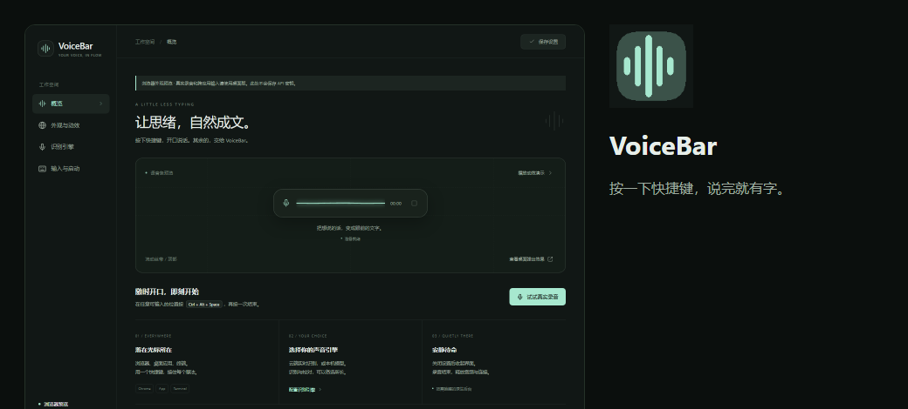

<div align="center">


# VoiceBar

**按下快捷键，说完就有字。** Windows 桌面语音输入条：Rust 原生后台、Tauri 2 + 系统 WebView2、无框架 TypeScript。

[](https://github.com/MLGBJDLW/VoiceBar/actions/workflows/ci.yml)
[](https://github.com/MLGBJDLW/VoiceBar/releases)
[](LICENSE)


[下载](#下载) · [快速开始](#快速开始) · [识别服务](#识别服务配置) · [开发](#开发) · [发布流程](#发布与版本)



</div>

---

VoiceBar 常驻托盘，在任意可输入的位置按一次快捷键开始说话，再按一次结束：文字落在光标所在处，不打断你正在用的应用。语音条有四种随音量起伏的动效，可以放在屏幕九宫格的任意位置，也能选本机模型或云端识别。

> 当前版本 **0.1.0**：首批开源版本，Windows 10/11 x64。安装包尚未签名，首次运行 SmartScreen 可能提示「未知发布者」，选择「仍要运行」即可。
>
> 国内网络下载慢时，可直接使用仓库里已构建好的 [0.1.0 安装包](docs/release/0.1.0/)。

## 功能

- **一个快捷键，贯穿桌面**：设置页直接按键录制组合键，支持 `Ctrl+Shift+Space`、`Alt+Q`、`F8` 等写法；保存时立即生效，被占用会给出明确提示。
- **落在光标所在**：浏览器、聊天软件、记事本、终端都能写入；用 Unicode 按键保留剪贴板，或切换为剪贴板粘贴兼容特殊应用。切换窗口会暂停自动写入，结果仍可复制。
- **九宫格弹出位置**：四角、上下左右、中央，跟随鼠标所在显示器，可加 X/Y 偏移；四种动效（流动丝带、声纹频带、涟漪轨道、节奏音柱）+ 柔光、颜色、透明度、响应强度、尺寸。
- **七种识别协议**：FunASR、whisper.cpp、阿里云 Paraformer、OpenAI Realtime、Deepgram、科大讯飞听写、OpenAI 兼容 HTTP 转写。
- **可选的二次校对**：录音结束后用任意 OpenAI Chat Completions 兼容模型修正错别字与标点，本机或云端均可。
- **开机自启**：设置里一键开关，只写入当前用户的 `Run` 注册表项，不弹管理员权限；卸载或关闭后立即清理。
- **单次快捷键开关**：托盘菜单、命令行 `--toggle` / `--cancel` 都能控制录音，方便绑定到键盘宏或 AutoHotkey。
- **隐私默认值**：密钥用 Windows DPAPI 加密，只对当前账户可解密；默认不保存录音与识别历史；空闲自动断开识别连接、停止动效。

## 下载

到 [Releases](https://github.com/MLGBJDLW/VoiceBar/releases) 下载：

| 文件 | 用途 |
|---|---|
| `VoiceBar_<版本>_x64-setup.exe` | 推荐。按用户安装，不需要管理员权限，自动创建开始菜单与卸载项 |
| `VoiceBar_<版本>_x64_en-US.msi` | MSI 安装包，适合组策略部署 |
| `VoiceBar_<版本>_x64_zh-CN.msi` | 中文 MSI 安装包 |
| `VoiceBar_<版本>_x64-portable.zip` | 免安装：解压后直接运行 `VoiceBar.exe`（需系统 WebView2） |
| `*.sig` | 若版本提供（配置了签名密钥时），用于自动更新校验 |

0.1.0 的文件也存放在本仓库 `docs/release/0.1.0/`，无需访问 Releases 即可下载。

需要 Windows 10/11 x64 与系统自带的 **WebView2 Runtime**（Windows 11 默认已装；Windows 10 可从微软官网安装）。

## 快速开始

1. 安装并打开 VoiceBar，点击左侧 **识别引擎**，选择识别协议，填写地址与自己的 Key，点 **测试连接**。
2. 保存设置。FunASR / whisper.cpp 需要自行启动本机模型服务，程序不内置也不自动下载模型。
3. 点击任意输入框，按 **Ctrl + Alt + Space**（可在「输入与快捷键」里改成你习惯的组合）开始，说完再按一次结束。
4. 第一次录音前确认：Windows 设置 → 隐私和安全性 → 麦克风 → 允许桌面应用访问麦克风。

## 识别服务配置

| 选择 | 默认地址 | 必填 | 方式 |
|---|---|---|---|
| FunASR | `ws://localhost:10095` | 无（服务启用鉴权时填 Token） | 实时预览 + 句末修正 |
| whisper.cpp | `http://localhost:8080/inference` | 无 | 录完后转写 |
| 阿里云 Paraformer | `wss://dashscope.aliyuncs.com/api-ws/v1/inference` | DashScope API Key | 实时流式 |
| OpenAI Realtime | `wss://api.openai.com/v1/realtime?intent=transcription` | API Key、转写模型 | 实时流式 |
| Deepgram | `wss://api.deepgram.com/v1/listen?...` | API Key | 实时流式 |
| 科大讯飞听写 | `wss://iat-api.xfyun.cn/v2/iat` | APPID、APIKey、APISecret | 实时，单次约 60 秒 |
| OpenAI 兼容 | 完整的 `/audio/transcriptions` 地址 | 服务所需 Key 与模型 | 录完后转写 |

- OpenAI 兼容可用于 OpenAI、Groq、硅基流动及本地 Whisper 服务，模型由服务器决定。
- 阿里适配的是 Paraformer 协议，不能直接换成 Qwen Realtime 模型名；腾讯、百度、Azure 等专有流式协议尚未接入。
- WebSocket 当前直连，仅开启 Windows 系统代理不会自动生效；HTTP 转写与校对使用 reqwest 的环境代理。
- 「测试连接」只验证握手/可达性，密钥权限与识别效果仍需实际录音验证。

命令行控制（程序已运行时）：

```powershell
VoiceBar.exe --toggle   # 开始 / 结束录音
VoiceBar.exe --cancel   # 取消当前录音
VoiceBar.exe --hidden   # 仅托盘启动，不打开设置
```

## 数据与隐私

- 配置：`%APPDATA%\studio.voicebar.desktop\settings.json`，密钥字段为 `dpapi:` 密文。
- 日志：`%LOCALAPPDATA%\VoiceBar\logs\startup.log`，仅启动阶段与错误信息，不含密钥和语音。
- 音频只发送到你配置的识别地址；校对模型只接收文字。无遥测、无云端统计。
- 开机自启项：`HKCU\Software\Microsoft\Windows\CurrentVersion\Run\VoiceBar`。

## 开发

要求 Windows 10/11 x64、Node.js 22.12+、Rust 稳定版 + Windows 链接工具（本机可用 `x86_64-pc-windows-gnu`，CI 使用 MSVC）。

```powershell
npm ci
npm run dev          # 浏览器里预览界面（不能录音）
npm run tauri dev    # 完整桌面开发
npm run build        # 类型检查 + 前端构建
npm test             # 前端测试（声浪 + 快捷键录制）+ Rust 测试
```

正式构建安装包（测试 → NSIS/MSI 安装包 → 按上限清理缓存）：

```powershell
powershell -ExecutionPolicy Bypass -File scripts/build.ps1                 # 安装包，与 CI 一致
powershell -ExecutionPolicy Bypass -File scripts/build.ps1 -Mode portable # 只产出根目录 VoiceBar.exe
```

生产构建必须启用 `custom-protocol` 把前端嵌入 exe；`tauri.conf.json` 已固定该 feature，遗漏会被编译期检查拦住。图标由 `node scripts/render-icons.mjs` 从 `src-tauri/icons/app-icon.svg` 生成（也可在 Actions 里运行 **Icons** 工作流），不依赖浏览器。前端 `npm run dev` 只监听本机 1420 端口。

贡献前请阅读 [CONTRIBUTING.md](CONTRIBUTING.md) 与 [安全策略](SECURITY.md)。实测范围与尚未验证的项目见 [验证记录](docs/verification.md)；仓库一次性配置（发布令牌等）见 [GitHub 设置清单](docs/github-setup.md)。

## 发布与版本

- **版本号来源**：`src-tauri/Cargo.toml`（Rust crate 版本）。`package.json` 与 `src-tauri/tauri.conf.json` 必须与之相同，CI 会检查；release-plz 会同步更新并提交 lockfile。
- **发版自动化**：[release-plz](https://release-plz.dev) 监听 `main`：按 Conventional Commits 生成 `CHANGELOG.md` 和版本更新 PR；该 PR 合入后创建 `vX.Y.Z` 标签和草稿 Release，GitHub Actions 在 Windows runner 上构建 NSIS/MSI 安装包、校验资产齐全后转为正式发布。
- **一次性配置**：在仓库 Settings → Secrets 添加 `RELEASE_PLZ_TOKEN`（具备 `contents: write` 的 PAT），否则 release-plz 创建的标签无法触发后续工作流。

详细步骤见 [CONTRIBUTING.md 的发布流程](CONTRIBUTING.md#发布流程维护者)。

## License

[MIT](LICENSE)。第三方识别服务的服务条款、计费与数据处理由其各自提供方决定。
